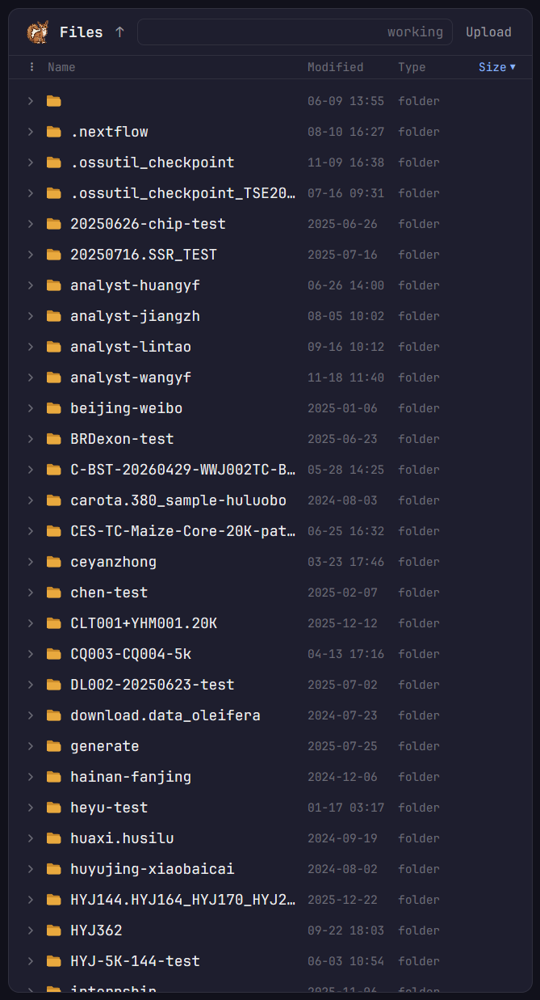

# Files Open

English | [简体中文](README.zh-CN.md)

A Herdr panel: the file tree of the folder the focused pane is in, with a colour icon
per file type. Text files preview in place. Anything the editor can't show (html, pdf,
images, office, archives) opens in your OS default app — at once for a local folder, or
after pulling it down when the pane is on a remote machine. Files go up by button or by
drag and drop, and come down the same way, without ever overwriting what is there.



## Install

```sh
git clone https://github.com/Raquelle97/herdr-files-open /tmp/files-open
cp -r /tmp/files-open/mods/files-open ~/.config/herdr-app/mods/
herdr-app check ~/.config/herdr-app/mods/files-open    # -> check passed
```

Windows (PowerShell):

```powershell
git clone https://github.com/Raquelle97/herdr-files-open "$env:TEMP\files-open"
Copy-Item -Recurse "$env:TEMP\files-open\mods\files-open" "$env:USERPROFILE\.config\herdr-app\mods\"
herdr-app check "$env:USERPROFILE\.config\herdr-app\mods\files-open"
```

Herdr docks it on the right the first time it sees the folder (`mod.json` says
`{ "place": "right", "size": 360 }`). If you already have a layout, put it there
yourself — a block whose content is `{ "mod": "files-open" }`.

## Use

- click a folder to expand it, again to close; **double-click** a folder to walk into it —
  it becomes the root of the tree, the header reads `…/name`, and `↑` beside it leads back
  out (the folder just left re-opens and is selected)
- click a text file to preview it in the panel; markdown renders as markdown
- **click the path in the header** and it turns into a box: type an absolute path, `~`, or
  a name relative to the folder on screen, then Enter. A path to a file opens its folder
  with that file previewed. While the tree sits somewhere else the header reads `…/name`
  and a `↩` next to `Files` takes it back to the pane's own folder
- a path it cannot use says why: `Not found: …`, `Permission denied: …`, `Not a folder: …`
  in red under the header for a few seconds, with the tree left where it was; an empty
  folder simply reads `This folder is empty`
- `~` is the home of **the machine the panel is looking at**: this computer for a local
  pane, and for a remote one the far side is asked once over the same channel the listings
  use — so a container whose `~` differs from what `ssh` reports still lands right
- click a pdf, image, docx, zip… to just select it — it needs a double-click or the menu
- **double-click** any file to open it in the OS default app
- **right-click** a row: Preview, Open with default app, Open with…, Download,
  Download to…, Copy path (folders: Download folder, Download folder to…,
  Upload files here…, Copy path) — a folder comes down whole, subfolders included
- **`Upload` in the header**, or `Upload files here…`, picks files from this computer and copies
  them into the folder on screen — over scp when the pane is on another machine
- **drag files or folders onto the panel** to upload them; with a folder row selected they
  land inside that folder
- a copy in flight draws a bar under the header — filled by how much of the destination has
  arrived ("Downloading data · 5.6 MB of 22.4 MB"), or a sliding highlight while the size
  is still unknown; uploads count items
- uploads and downloads never overwrite: a clash becomes `name (1).ext`
- a finished download opens the folder it landed in (Finder selects the file itself;
  `"reveal": false` turns this off)

## Sorting

The list is a four-column table: name, modified, type, size. Click a column header to sort
by it, click it again to reverse — a small `▲`/`▼` on the header points the way. Folders
always come first, ties fall back to the name, and digits compare as numbers (`file2` sorts
before `file10`).

The order lives on the view rather than on one listing, so a refresh, a jump or a walk up
the tree keeps it.

A layout can pick the opening order:

```json
{ "mod": "files-open", "props": { "sort": "date", "sortDesc": true } }
```

## Columns

`⋮` at the left of the table header — or a right-click on any column label — opens the
columns menu:

- `✓` is whether the column shows; click the mark to hide it, click again to bring it back.
  Name is the row itself, so it never hides.
- `←` `→` move that column past its visible neighbour; the arrow greys out at either end.

Both survive a restart, because they live in `mods/files-open/config.json`:

```json
{ "columns": ["size", "date"], "hiddenColumns": ["type"] }
```

Any column not named there follows in the default order: modified, type, size.

## Config

`mods/files-open/config.json` is read on every download, so an edit applies at once:

```json
{ "downloadDir": "D:/Downloads", "reveal": false }
```

That is where a remote file lands before the OS opens it, and where `Download` puts a copy
(default `~/Downloads`; `cacheDir` is the older name for the same setting). A local file
opens in place — nothing is copied unless you ask for it. `Download to…` saves wherever you
pick and remembers that folder for next time. `reveal` (default `true`) is whether a
finished download opens the folder in the file manager.

## Limits

- it lists, previews, opens, uploads and downloads copies; it does not rename or delete
- 500 entries per folder, 5 000 across the tree, 400 KB per preview
- a remote preview reads the file over that machine's channel; long files are truncated
- binary files are reported as such instead of decoded
- a drop has to land on the panel itself; anywhere else it is Herdr's own drop

## Icons

`mods/files-open/ftypes/*.svg` — 21 file families plus closed and open folders. They are
full-colour SVGs loaded with `image()`; `svg()` would use them as a theme-tinted mask and
flatten every colour. To map more extensions, extend `EXT_ICON` (by extension) or
`NAME_ICON` (by file name) in `main.js`. `gen_file_icons.py` rewrites the whole set after
you change a colour.

| | | | |
|---|---|---|---|
| `</>` js / ts / py / code | browser html / css / vue | `{}` json / yaml / toml | `M↓` markdown |
| `>_` sh / bash / ps1 | cylinder sql / db | page pdf | page doc |
| grid xls / csv / tsv | screen ppt | mountain png / jpg | note mp3 / wav |
| play mp4 / mov | box zip / tar | blocks exe / so | lock .env / .pem |
| branch .gitignore | page txt / log | folder / folder open | |

## Licence

Apache-2.0, see [LICENSE](LICENSE). This is a derivative of the `files` mod that ships
with Herdr (Apache-2.0); the chevrons are Lucide icons (ISC).
