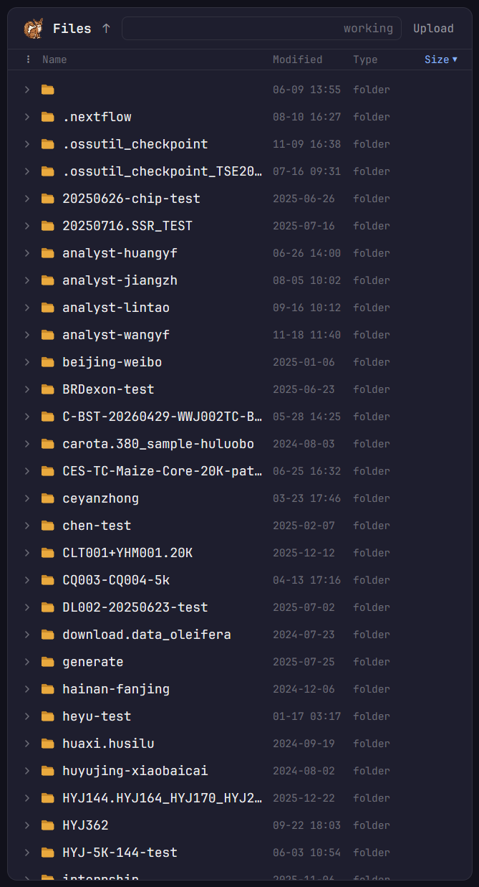

# Files Open

[English](README.md) | 简体中文

一个 Herdr 面板：把当前聚焦终端所在目录的文件树摆在侧边，每种文件类型配一个有颜色的图标。
文本文件就地预览；编辑器显示不了的东西（html、pdf、图片、office、压缩包）交给系统默认程序打开——
本地目录立刻打开，终端在远程机器上则先拉下来再打开。文件既能用按钮上传，也能直接拖进面板；
下载也是同一套路，而且从不覆盖已有的同名文件。



## 安装

```sh
git clone https://github.com/Raquelle97/herdr-files-open /tmp/files-open
cp -r /tmp/files-open/mods/files-open ~/.config/herdr-app/mods/
herdr-app check ~/.config/herdr-app/mods/files-open    # -> check passed
```

Windows（PowerShell）：

```powershell
git clone https://github.com/Raquelle97/herdr-files-open "$env:TEMP\files-open"
Copy-Item -Recurse "$env:TEMP\files-open\mods\files-open" "$env:USERPROFILE\.config\herdr-app\mods\"
herdr-app check "$env:USERPROFILE\.config\herdr-app\mods\files-open"
```

Herdr 第一次看到该目录时会把它停靠在右侧（`mod.json` 里写着 `{ "place": "right", "size": 360 }`）。
如果你已经有自己的布局，就手动加一块，内容为 `{ "mod": "files-open" }`。

## 使用

- 点文件夹展开、再点收起；**双击**文件夹进入它——它成了树的根，标题栏变成 `…/名字`，
  旁边的 `↑` 退回上一级（退回去时刚离开的那个文件夹会自动展开并选中）
- 点文本文件在面板里预览；markdown 按 markdown 渲染
- **点标题栏里的路径**，它会变成一个输入框：绝对路径、`~`、或相对当前目录的名字，
  回车即跳转。输入的是文件路径时，跳到它所在目录并预览该文件。跳走之后标题栏显示
  `…/名字`，`Files` 旁边的 `↩` 一键回到终端自己的目录
- 路径不认识时有明确说法：`Not found: …`、`Permission denied: …`、`Not a folder: …`
  （显示在标题栏下方，红色，几秒后消失），原来的目录保持不动；空目录则直接写
  `This folder is empty`
- `~` 展开成**面板所看的那台机器**的主目录：本地面板是本机，远程面板问那台机器一次
  （走和列目录同一条通道，所以容器里的 `~` 和 `ssh` 报的不一样时也对得上）
- 点 pdf、图片、docx、压缩包……只是选中它——打开需要双击或走右键菜单
- **双击**任意文件，用系统默认程序打开
- **右键**某一行：Preview、Open with default app、Open with…、Download、Download to…、
  Copy path（文件夹则是：Download folder、Download folder to…、Upload files here…、Copy path）——
  文件夹会整体下载，包含所有子目录
- **标题栏的 `Upload`** 或 `Upload files here…`：从本机挑文件，复制到面板当前显示的目录里；
  终端在远程机器上时走 scp
- **把文件或文件夹拖到面板上**即上传；若某一行文件夹是选中的，就落进那个文件夹
- 复制过程中，标题栏下方会出现进度条：按落地目录已经到达的字节填充
  （`Downloading data · 5.6 MB of 22.4 MB`）；大小还算不出来时是一段滑动的高亮。上传按条目计数
- 上传和下载都不覆盖：撞名会变成 `name (1).ext`
- 下载完成后会弹出它落地的那个文件夹（macOS 上会直接选中文件；`"reveal": false` 可关掉）

## 排序

列表是一张四列的表：名称、修改日期、类型、大小。点列头按该列排序，再点同一列则反向，
列头上的小三角指着方向（`▲` 升序 / `▼` 降序）。文件夹永远排在最前面，同值时按名称兜底，
名字里的数字按数值比（`file2` 在 `file10` 前）。

排序状态记在这个视图上而不是某次列目录的结果里——刷新、跳转、进上级目录之后都还在。

布局也可以指定开局顺序：

```json
{ "mod": "files-open", "props": { "sort": "date", "sortDesc": true } }
```

## 列

**直接拖列头就能换位**：按住 `Modified`、`Type` 或 `Size`，拖到另一列上松开，
它就会落在那一列的位置（落点那列上有强调色竖线提示）。拖拽时的单击不会误触发排序。

也可以用表头左边的 `⋮`（或右键任意列头）打开列菜单：

- `✓` 那一列的开合状态，点一下隐藏、再点显示——名称列是行本身，不能隐藏
- `←` `→` 把这一列和相邻的可见列换位（到头就变灰）

隐藏和顺序都记在 `mods/files-open/config.json` 里，重启后还在：

```json
{ "columns": ["size", "date"], "hiddenColumns": ["type"] }
```

没写的列会按 修改日期、类型、大小 的默认顺序补在后面。

## 配置

每次下载都会读 `mods/files-open/config.json`，改完立即生效：

```json
{ "downloadDir": "D:/Downloads", "reveal": false }
```

这既是远程文件交给系统程序打开前的中转位置，也是 `Download` 复制到的位置
（默认 `~/Downloads`；`cacheDir` 是同一设置的旧名字）。本地文件就地打开——你不要求就不会复制。
`Download to…` 存到你挑选的目录，并记住这个选择供下次使用。`reveal`（默认 `true`）
决定下载完成后是否弹出文件管理器打开目标目录。

## 更新提醒

面板可以在启动时看一眼自己的新版本，命中就在这里列一条横幅：

```
↑ v1.6.0 可用 · 当前 1.5.0     更新说明  稍后  ✕
```

`更新说明` 用浏览器打开发布页；`稍后` 静音 24 小时；`✕` 这一版不再提醒
（下一版还会提醒）。两者都记在 `mods/files-open/state.json`，重开面板仍然有效。

在 `config.json` 里指定仓库即开启，没填就完全不发请求：

```json
{ "updates": { "repo": "you/files-open", "check": true, "intervalHours": 6 } }
```

`repo` 走 GitHub 的 `releases/latest`（取 `tag_name`）；私有仓库或想用别的地址，
可改 `feed` 指向一个返回 `{"version": "1.6.0", "url": "…", "notes": "…"}` 的地址，
并用 `token` / `tokenEnv` / `tokenFile` 提供令牌（`tokenEnv` 从环境变量读，`tokenFile`
读文件第一行，令牌就不用写进配置）。本地版本取 `mod.json` 的 `version`（没有则取
`config.json` 的 `version`）。

## 限制

- 它只负责列出、预览、打开、上传和下载副本；不改名、不删除
- 每个文件夹 500 项，整棵树 5 000 项，单次预览 400 KB
- 远程预览通过该机器的通道读取文件；超长文件会被截断
- 二进制文件只标注类型，不做解码
- 拖拽必须落在面板本身；落在别处是 Herdr 自己的拖放

## 图标

`mods/files-open/ftypes/*.svg`——21 个文件家族，外加打开/关闭两种文件夹。它们是全彩 SVG，
用 `image()` 加载；换成 `svg()` 会被当成主题色遮罩，颜色全被抹平。想映射更多扩展名，
在 `main.js` 里扩 `EXT_ICON`（按扩展名）或 `NAME_ICON`（按文件名）；改了配色后
用 `gen_file_icons.py` 重新生成整套。

| | | | |
|---|---|---|---|
| `</>` js / ts / py / code | browser html / css / vue | `{}` json / yaml / toml | `M↓` markdown |
| `>_` sh / bash / ps1 | cylinder sql / db | page pdf | page doc |
| grid xls / csv / tsv | screen ppt | mountain png / jpg | note mp3 / wav |
| play mp4 / mov | box zip / tar | blocks exe / so | lock .env / .pem |
| branch .gitignore | page txt / log | folder / folder open | |

## 许可

Apache-2.0，见 [LICENSE](LICENSE)。本项目派生自 Herdr 自带的 `files` mod（Apache-2.0）；
折叠箭头来自 Lucide 图标（ISC）。
