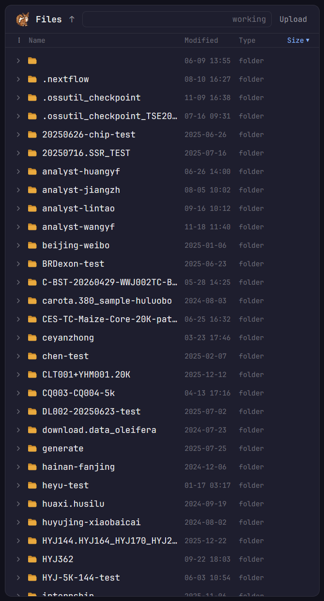

# Files Open

A file tree for the folder of the focused pane, with a colour icon per file type. Text
files preview inside the panel; everything else (html, pdf, images, office, archives)
opens in the OS default app, downloading it first when the pane is on a remote machine.
Expanding a folder lists it then and there, right-click copies the absolute path.

## What you see

One panel, 360 px wide by default, docked at the right of the window. A rounded card
(radius 10, 1 px border in the theme's border colour, background `background`) holding:

- **Header**, 42 px, 14 px side padding, 8 px gaps, border beneath. Left to right: `←`
  (only while a file is previewed, 20 px, `muted`, goes back to the tree), the previewed
  file's 15 px colour icon (same condition), the panel's own mark — `logo.png`, the pixel
  Somali cat, 24 x 24 — then the word `Files` in semibold, `↩` once the
  tree has been jumped away from the pane's own folder, `↑` (goes to the parent folder;
  `border` colour instead of `muted` when there is nowhere to go), then pushed right a
  single line in 12 px `dim` — the previewed file's path, or the folder's name (`…/name`
  after a jump) — which truncates with an ellipsis and is the same hit target for
  right-click copy. Then the word `Upload` (11.5 px, `muted`, `foreground` on hover).
  The path line is drawn as a field — 24 px tall, 6 px radius, 1 px `border`, right
  aligned, `accent` border and `foreground` text on hover — so it reads as the place to
  type. Click it and it becomes an `Input` holding the full path, selected; see the
  address bar below. When a file is previewed, `↗` (6 px padding, `muted`, `foreground`
  on hover) opens it in the OS app.
- **Table header**, 21 px, 14 px side padding, 7 px gaps, border beneath, 10.5 px labels in
  `dim`: `⋮` (opens the columns menu), `Name` (flexing), then the visible value columns in
  their configured order at fixed 74 / 46 / 54 px. The column in force is `accent`-coloured
  and carries an 8 px `▲` (ascending) or `▼`. Clicking a label sorts by it, clicking it
  again reverses; right-clicking one opens the same columns menu. A value column can also be
  dragged onto another: the one in hand goes to 45 % opacity, the one under the pointer gets
  a `hover` background and a 2 px `accent` bar on its leading edge, and the drop lands the
  column on the side it came from. The `⋮` is first because
  `Name` is the only cell that flexes — anywhere else and every column after it would shift
  by its width and stop lining up with the values.
- **Tree**, 6 px padding, scrolling. Rows are 28 px tall, 7 px rounded, 8 px + 18 px per
  depth of left padding, 8 px right, 7 px gaps, `hover` background under the pointer.
  Each row: a 12 px chevron in `dim` for folders (down when open, right when closed) or a
  12 px gap for files; a 15 px full-colour icon; the name, 13 px, flexing and truncating;
  then the three fixed columns in 10.5 px `dim` — the timestamp (`11-18 17:05`, or
  `2025-11-18` outside this year), the extension (`folder` for a directory, `—` when it
  has none) and the size (`315 KB`; blank for a folder); `↗` for a file type that opens
  externally; a git mark letter when the worktree reports one (`A` green, `D`/`U` red,
  other `blocked`).
- **Preview**, the rest of the card: a read-only editor for a text file, or a 12 px
  `dim` line saying what is happening ("Downloading from login07…", "Cannot open: …").
  Empty folders and errors show a 12 px line inside the tree instead — `This folder is
  empty`, or the reason in `ansi1`.

Folders sort first, then the chosen field, then the name as a tie-break. Names compare
case-insensitively with digits as numbers (`file2` before `file10`); `.git` is hidden.

## How it behaves

- The tree follows `focused()`: the pane's `cwd`, the tab's, else the space's folder, and
  it remembers which folders were expanded per location. It re-reads on focus change and
  every 10 s; a local folder is also watched with `watchFolder` and re-read when it moves.
- Clicking a folder expands it (lazily listing just that folder, 500 entries at a time)
  and clicking again collapses it; the row is the only control, no hover arrows.
- Clicking a text file reads it over that machine's channel and shows it in a read-only
  `Editor` with the theme's syntax colours; over 400 KB it is cut with "… (file
  truncated)". A file with a NUL byte says "Binary file · no text preview".
- Clicking a type in the external list (html, pdf, images, audio, video, office, archives,
  executables) hands it to the OS: `explorer.exe`, `open` or `xdg-open`. A local file is
  opened where it is; a remote one is first `scp`-ed to the cache folder (see below) — the
  header says so while it runs.
- Right-click on a row opens this mod's own 236 px popup, one row per action: Preview,
  Open with default app, Open with…, Download, Download to…, Copy path for a file;
  Download folder, Download folder to…, Upload files here…, Copy path for a folder.
- Copy path (in the popup, or right-clicking the path in the header) writes that path to
  the clipboard exactly as that machine spells it (`\` for a Windows folder, `/` elsewhere)
  and shows `✓` where the name was for 1.4 s.
- A download is one `Copy-Item -Recurse` / `cp -Rp`, or one `scp -r` when the pane is on
  another machine, into the config folder or a folder the picker returns; a name already
  taken becomes `name (1).ext` rather than being overwritten. A folder into its own
  subfolder is refused instead of recursing for ever.
- A finished download opens the folder it landed in — `explorer.exe <folder>` (Windows),
  `open -R <file>` (macOS), `xdg-open <folder>` (Linux) — unless `config.json` says
  `{"reveal": false}`. Not awaited: the file is saved either way.
- **Why Windows opens the folder and not the file.** `/select,<path>` is Explorer's way to
  highlight a file, but it needs the switch and the path on one command line. Handed over
  through `exec` as one argv token (`["/select,C:\dir\f.txt"]`) Explorer rejects it and
  falls back to its *default* folder — Documents, or Desktop — so people got the wrong
  window every time. Quoting the path inside the token, splitting it into
  `["/select,", path]`, `cmd /c explorer.exe /select,"…"`, and
  `Start-Process explorer.exe -ArgumentList '/select,"…"'` were all tried at runtime and all
  failed the same way (the quotes don't survive `exec`'s argv round-trip into `cmd`). A plain
  folder path is the only form that lands, and it is what the request was for anyway.
  `open -R` on macOS has no such problem — its switch is `-R`, not a leading slash.
- **The address bar.** Clicking the path line sets `editing`, fills the `InputState` with
  the full path (or the previewed file's) and selects it, so typing replaces it and Enter
  alone changes nothing; `submit` runs `jumpTo`, `blur` drops back to the plain field. A
  typed path goes through `resolvePath`: `~` and `~/…` become the machine's home (asked
  once per machine through the listing channel — a container's `~` is not what `ssh`
  reports), a bare name is joined to the folder on screen, `\` becomes `/`, and `..` is
  folded by hand — so a jump never shows a `../..` root. The target is then listed with
  `directory()`; success moves the tree there, failure is retried against the target's
  parent, and if the parent does list a *file* of that name the tree moves there and
  previews it. Anything else reports why, in red under the header for 4.2 s, with the tree
  left where it was: `Not found: <path>`, `Permission denied: <path>`, `Not a folder:
  <path>`. The reason comes from an exit code — the sh script exits 2 missing, 3
  unreadable, 4 not-a-directory, and the Windows listing exits the same way after its own
  `Test-Path -PathType Container` — so the common cases need no message parsing.
- **Column headers sort.** `setSort` flips the direction when the field is already the one
  in force, otherwise switches field and starts ascending; `resortAll()` re-sorts the
  arrays in hand, so a click costs no listing. `sorted()` puts folders first, then
  `compareBy(field)`, then the name; the sign of the comparison flips with `sortDesc` but
  the tie-break stays ascending. `sortKey`/`sortDesc` live on the view, which is why a
  refresh (`loadFolder` → `sorted`) and a jump (`land` → `sorted`) keep the order. A layout
  can seed them with `props: {"sort": "date", "sortDesc": true}`.
- **Columns drag.** A press on a value column's label sets `dragCol`, `on_mouse_move` on
  each label records `overCol` (the element under the pointer is the target — no pointer
  maths, no capture), and the release runs `dropCol`, which rebuilds `colOrder` with the
  dragged key spliced in beside its target on the side it came from. `droppedAt` swallows
  the click that the same release fires, so a drag never also sorts. A release anywhere
  else in the card just clears both, which the root's `on_mouse_up` does.
- **Update banner.** `checkUpdate` runs in `init`, reads `updates` from `config.json` and
  asks at most once per `intervalHours`, caching the answer in `state.json` (`latest`,
  `checkedAt`) so a restart neither re-asks nor forgets. `versionNewer` compares numeric
  parts, `localVersion()` reads `mod.json`'s `version` and falls back to the config's. A
  newer version renders a 26 px strip under the header: `更新说明` opens the release page,
  `稍后` writes `snoozeUntil` (+24 h), `✕` writes `dismissedVersion`; both are read back
  before the banner is allowed to appear again.
- **Double-click a folder walks in** (`enter` → `jumpTo` with a relative path, so it becomes
  the root); `↑` calls `goUp`, which asks `parentOf` for the parent, jumps there and passes
  `{expand: base(oldRoot)}` so `land` re-opens and selects the folder just left. A single
  click keeps the in-place expand.
- **Columns hide and move** from the `⋮` menu, which is this mod's third popup: `ask()` leaves
  `{what: "coltoggle" | "colmove"}` for `takeIntent`, so the work happens in the view that
  owns the tree. `colOrder` keeps every key in display order and `colHidden` says which of
  the three are off; `visibleCols()` is what both the header and the rows walk, so they
  cannot drift apart. Hiding and moving call `saveCols()`, which merges into `config.json`
  with `writeTextFile(path, text, before)` — the `before` is what makes a concurrent edit
  fail instead of being clobbered. `loadCols()` reads the same two keys in `init` and
  appends any key the file does not mention.
- A jump rewrites `this.context.cwd` as well as `this.root`: `loadFolder` reads the folder
  out of its `context` argument, and the 10 s refresh keys off `location()`, which the jump
  does not change — only the context edit makes the next reload land in the new folder.
  `this.baseCwd` keeps the pane's own folder, which `↩` jumps back to.
- Uploads and drag-and-drop copy the other way with the same no-overwrite rule.
- A copy in flight owns a bar under the header. The free name is chosen first, then the
  source's size, then the destination is sampled every 700 ms — one `du` or PowerShell per
  sample, never per frame — and the fill is a div sized to `done / total` with
  `transition("width", 240)`. No size (a failed measure, or a source that cannot be
  counted) leaves it indeterminate: a 96 px fill sliding on a native `loop("left")`.
  Uploads need no sampling: the item counter is the progress.
- There is no key handling beyond the address bar's own `Input`: no focus, no shortcuts.

## Built from

`mods/files-open/` — `main.js` (one `View`), `mod.json`
(`{ "place": "right", "size": 360 }`), `ftypes/*.svg`, `chevron-down.svg`,
`chevron-right.svg`, and `gen_file_icons.py` which regenerates `ftypes/` (Python 3,
standard library only).

- `herdr`: `spaces`, `panes`, `focused`, `exec`, `readTextFile`, `watchFolder`, `theme`,
  `settings`, `window`, `home`, `appHome`, `notify`.
- `gpui-kit`: `div`, `svg`, `image`, `View`; `gpui-base`: `v_flex`, `h_flex`, `Editor`,
  `EditorState`, `TextView`, `Input`, `InputState`.
- Listing: `sh -c` with a `printf` loop for a POSIX folder; PowerShell
  `Get-ChildItem -Force` for a Windows local folder; `exec(..., { on })` sends either to
  the pane's machine.
- Opening: `scp -q -B` into `{ "cacheDir": … }` from `config.json` (default
  `~/herdr-open`), then `explorer.exe` / `open` / `xdg-open`.
- Icons: `image()`, never `svg()`, so their own hex colours survive.

## Watch out

- `image()` keeps an SVG's colours, `svg()` uses it as a theme-tinted mask. Every icon in
  `ftypes/` therefore carries explicit `fill`/`stroke` hex values — no `currentColor`.
- The icon path is built as `ftypes/file-<kind>.svg` for files and `ftypes/<folder|folder-open>.svg`
  for folders. Get either side wrong and the row renders *nothing at all* — no error, no
  placeholder — so a blank icon almost always means the path, not the cache.
- `mod.json`'s `place` docks a copy only the first time Herdr sees the folder. Changing it
  later does nothing to an existing layout.
- Saving any file in the mod reloads it in place, which drops the expanded folders; they
  are not persisted.
- The Windows listing runs PowerShell, so the path is passed single-quoted with `'` and
  the curly quotes (`‘ ’ ‚ ‛`) doubled — PowerShell reads those as quotes too. It also
  sets `OutputEncoding` to UTF-8, or non-ASCII names come back garbled.
- A symlinked folder keeps the directory attribute even when dangling, hence the
  reparse-point test before calling an entry a folder.
- Hard caps: 500 entries per folder, 5 000 in the tree, depth 40, 400 KB per preview.
- A panel block's `props` are visible to it (`props()`), which is how a jump was tested
  without a mouse: `{"mod": "files-open", "props": {"probe": "/some/path"}}` in the layout,
  a one-shot timer in `init`, then `layout.switch` to rebuild the panel. The probe is gone
  from the shipped file.
- `explorer.exe` exits 1 even when the window opens, so the reveal is wrapped in a
  `try {} catch {}` like the other launchers.

## Done when

1. `herdr-app check mods/files-open` prints `check passed`.
2. With a pane in a folder of mixed types, the panel lists folders first and shows a
   different colour icon for a `.py`, an `.md`, a `.xlsx`, a `.pdf` and a folder.
3. Clicking a `.py` shows its source with syntax colours; `←` returns to the tree.
4. Clicking the `.pdf` opens it in the OS default app; on a remote pane the header says
   "Downloading from <machine>…" first and the file appears in the cache folder.
5. Right-clicking a row shows `✓` and paste puts that absolute path in the clipboard.
6. A folder with more than 500 entries still opens, with the "limited" note under the tree.
7. Clicking `Size` orders by size, a second click reverses it, a `▼` on the header says
   which way; `↑` then walks up and the order survives the move.
8. Double-clicking a folder makes it the root (`…/name` in the header); `↑` returns, and
   the folder just left is open and selected.
9. Typing `~/…` in the path field lands in the machine's home, `nope/xyz` says
   `Not found: <path>` in red and leaves the tree alone, and an empty folder says
   `This folder is empty`.
10. `⋮` in the table header hides `Type` and moves `Size` before `Modified`; both are still
    that way after the app restarts, and `config.json` carries `columns`/`hiddenColumns`.
11. Dragging the `Size` label onto `Modified` puts `Size` first, the accent bar shows where
    it will land, the drag does not also sort, and the new order survives a restart.
12. With `updates.repo` (or `feed`) set to something newer than `mod.json`'s version, the
    strip appears under the header; `稍后` hides it for a day and `✕` for that version,
    both across a restart, and with the keys empty no request is made at all.
